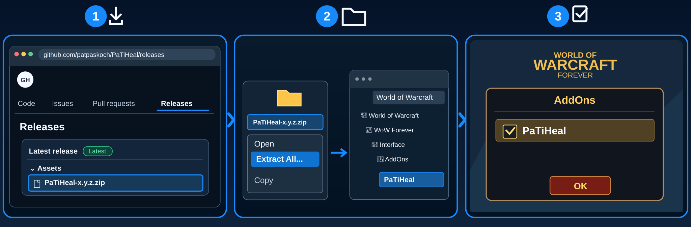

# PaTiHeal

**📥 [Download PaTiHeal Beta](https://github.com/patpaskoch/PaTiHeal/releases/download/v0.6.0-beta.1/PaTiHeal-0.6.0-beta.1.zip)** · [Installation guide](#installation)

*Installation-test preview — not yet a stable release.*

## What is PaTiHeal?

**Your party needs a healer. You need PaTiHeal.**

When the fight gets chaotic, every second matters. PaTiHeal keeps your party in focus and puts healing, cleansing and lifesaving decisions right at your fingertips — without the clutter. React faster, stay in control and heal **your way**, with an interface built for the moments that matter most.

## Features

- **Flexible Click-Healing:** Assign your own spells and ranks to nine mouse-click and modifier combinations.
- **Decursive-style dispelling:** Spot removable debuffs and click their icons to cleanse.
- **Party & target frames:** Health, mana, tank highlight, and a separate friendly target.
- **HoTs & shields:** Track your own effects, charges, and remaining durations.
- **Resurrection:** Left-click dead party members outside combat (Priest and Shaman in this beta).
- **Mana call:** Tell your group you need mana and trigger `/oom` with one click.
- **Make it yours:** Themes, scaling, language, test mode, and an optional PaTiAlerts integration.

## Installation

1. 📥 **Download** – Open [GitHub Releases](https://github.com/patpaskoch/PaTiHeal/releases) and download the `PaTiHeal-<version>.zip` file under **Assets** (not **Source code (zip)**).
2. 📂 **Extract & Copy** – Right-click the ZIP, select **Extract All**, then copy the extracted `PaTiHeal` folder into the WoW Forever client's `Interface/AddOns/` folder. No renaming is needed.
3. ☑️ **Enable in Game** – Start WoW, open the **AddOns** menu at character selection, tick **PaTiHeal**, and click **OK**.

## Getting Started

- `/ph settings` → Click casting: choose a spell for e.g. Left Click; "HoTs & shields" for the frame icons
- `/ph test` shows example frames (clicks do nothing in test mode)
- `/ph` shows or hides the window; drag it by its header

## Settings

`/ph settings` or ••• → Settings:
- **Click casting:** a spell and rank per click combination; dispel spells are in the same list (click dispel)
- **HoTs & shields:** each aura on/off, timers, charges, position (right of or below the health bar)
- **Mana call:** Mana button on/off; when it lights up (never, below 20/30/40/50 % mana); message language (English or interface language)
- **General:** language, scale (applied after combat if changed in combat), window lock, dispellable debuffs on/off
- *Restore Defaults* keeps your click bindings and the window position.
- **Window:** panel opacity (30–100 %)

## PaTiSuite

This addon is part of the **PaTiSuite** — a collection of small addons for World of Warcraft: Forever.
Each one is installed on its own and works on its own; none of them is needed by another.

- [PaTiSuite](https://github.com/patpaskoch/PaTiSuite) – optional control panel to show and hide the PaTi windows
- **PaTiHeal** – healing: party frames, heal target, click casting, HoTs, dispels *(this addon)*
- [PaTiAuras](https://github.com/patpaskoch/PaTiAuras) – buffs, procs, tracking, group buffs and weapon imbues
- [PaTiAggro](https://github.com/patpaskoch/PaTiAggro) – aggro for tank, healer and damage (formerly PaTiTank)
- [PaTiRota](https://github.com/patpaskoch/PaTiRota) – your own skill priority with cooldowns and fixed cast buttons
- [PaTiGroup](https://github.com/patpaskoch/PaTiGroup) – party awareness: tank, healer, roles and the tank's target
- [PaTiLead](https://github.com/patpaskoch/PaTiLead) – lead the group: raid markers, ready check and pull timer
- [PaTiQuest](https://github.com/patpaskoch/PaTiQuest) – selected quest and its objectives
- [PaTiDungeon](https://github.com/patpaskoch/PaTiDungeon) – instance, group and combat status
- [PaTiSocial](https://github.com/patpaskoch/PaTiSocial) – "Party Social": quick emote and message buttons
- [PaTiAlerts](https://github.com/patpaskoch/PaTiAlerts) – one window for open problems

### Goes well with (optional)

- [PaTiAuras](https://github.com/patpaskoch/PaTiAuras) – extra buff and aura watch next to your party frames
- [PaTiAlerts](https://github.com/patpaskoch/PaTiAlerts) – shows party members with a dispellable debuff in one central window
- [PaTiSuite](https://github.com/patpaskoch/PaTiSuite) – control panel to show and hide all PaTi windows

## Commands

`/ph` or `/patiheal` — alone: show/hide · `settings` · `test` · `show` · `hide` · `lock` · `unlock` · `reset` (position) ·
`spells` (known heals with ID) · `auras` (which HoT/shield/dispel spells your client knows) · `debug` · `version`

Hide, collapse, test mode and reset are blocked in combat (WoW does not allow changing secure frames then).
Click-casting changes made in combat apply after combat.

## Known limitations

- HoT/shield and dispel spell IDs are not yet confirmed in the Forever client — `/ph auras` shows what it knows.
- Not yet tested in game: rank choice, dispel icons, HoTs & shields, click dispel.
- Party only (no raid frames).
- The mana message text is fixed per language (not editable yet). Whether WoW Forever lets addons send chat from a
  click in combat and whether your own mana is readable in combat is not confirmed yet.

## Development

Architecture, tests and engineering rules of the suite: [PaTiAdmin](https://github.com/patpaskoch/PaTiAdmin). PaTiAdmin is not a WoW addon — players do not install it. The shared UI code (PaTiShared) is already embedded in this addon's `Shared/` folder; there is nothing extra to install.

## Support

PaTiHeal is free and open source, and it stays that way. If it makes your runs a bit better, you can buy me a coffee:
[ko-fi.com/patiaddons](https://ko-fi.com/patiaddons). Bug reports and ideas are just as welcome:
[Issues](https://github.com/patpaskoch/PaTiHeal/issues).

## License

MIT — see [LICENSE](LICENSE). Copyright (c) 2026 Patrick Koch.
